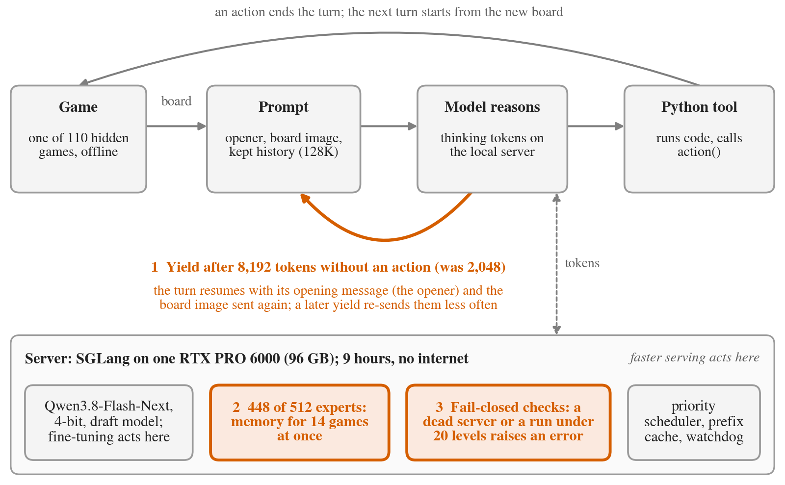
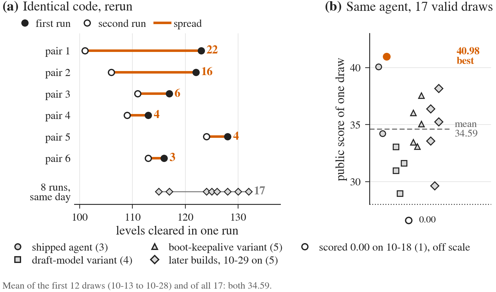
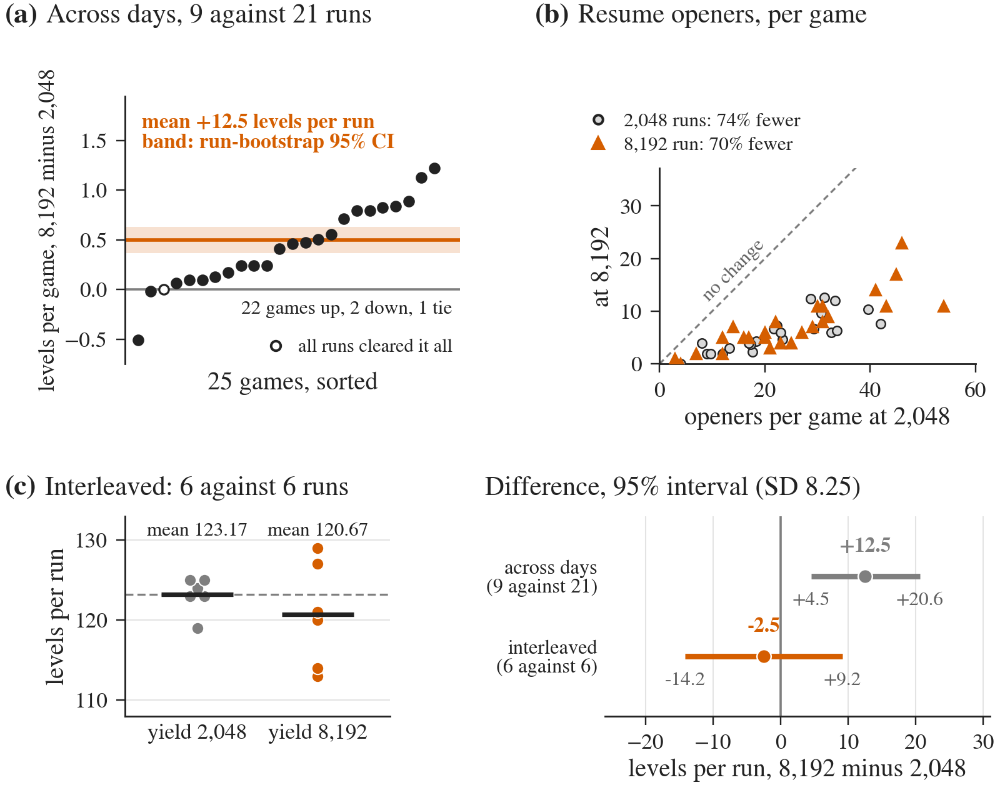
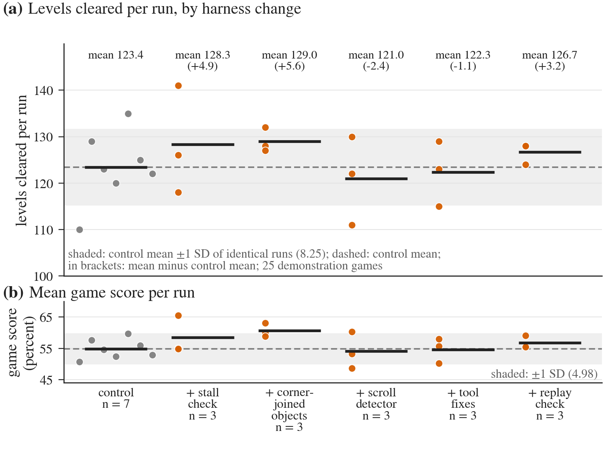
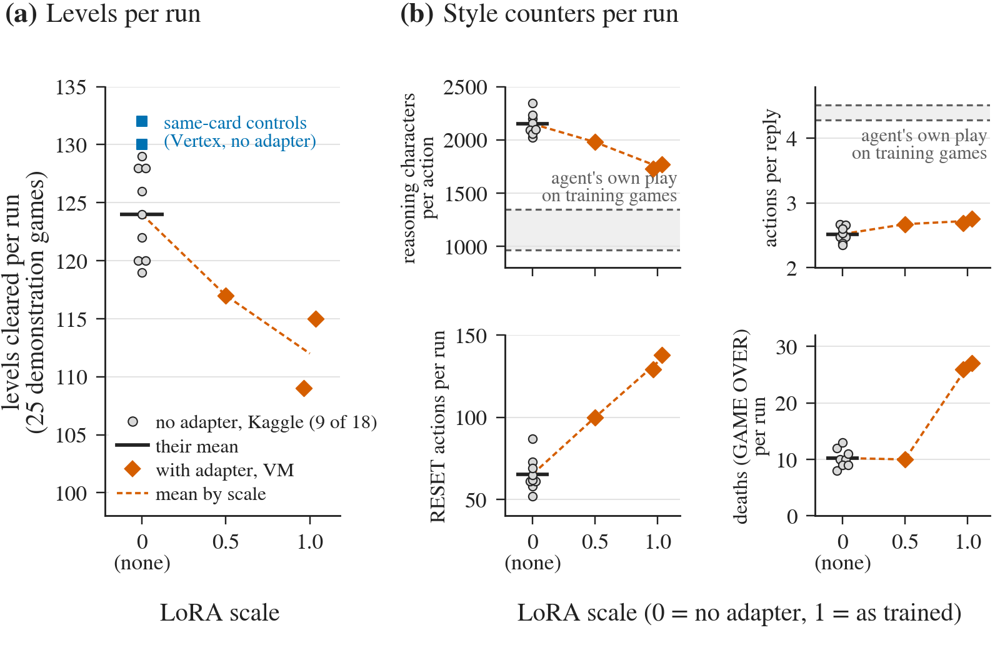

# Decisions or Tokens? What Moves an Offline ARC-AGI-3 Agent, and How to Tell

*Identical code cleared 123, then 101 of 183 levels. We size that noise, show a 12.5-level gain stop reproducing, and find that fine-tuning on its own wins ran lower than same-card controls, though not interleaved.*

<!-- COVER: paper/v3/figs/cover_1600x900.png goes in the Media Gallery as the cover image, not in the body. Title and subtitle go in their own Kaggle fields; the body starts at the opening paragraph (the hook), then the Accuracy line. -->
<!-- IMAGES TO UPLOAD (Kaggle takes images separately; the ../figs paths below do not render there). Upload each file, then replace its path with the uploaded URL and keep the italic caption under it:
1. paper/v3/figs/fig_loop_writeup.png, under "Approach" (Figure 1)
2. paper/v3/figs/fig_noise_draws_writeup.png, under "Identical code, different scores" (Figure 2)
3. paper/v3/figs/fig_yield_writeup.png, under "A context lever that failed an interleaved test" (Figure 3)
4. paper/v3/figs/fig_gates_writeup.png, under "Fixing what the model is shown" (Figure 4)
5. paper/v3/figs/fig_finetune_writeup.png, under "Imitating easy wins" (Figure 5)
Cover (Media Gallery only): paper/v3/figs/cover_1600x900.png. Alt text for all: ALT_TEXT.md. -->

The same code cleared 123 of 183 levels, then 101. Decisions or tokens? At that noise most gains, ours included, cannot be told from chance: a faster server (+11% tokens) is worth about 4 levels and four harness changes led a control by -1 to +6. A 12.5-level gain across days from re-sending context less often did not reproduce once runs were interleaved. The contribution is a method: size the noise first. Scope: one stack, 25 public games, usually two to seven runs per arm.

**Accuracy.** Public score 40.98 (submission 57417773, 2026-10-20), public rank 26 of 5,073 at the deadline, on half of the 110 hidden games: our best of 28 live *draws* (scored runs, one a day) since forking Franzen's notebook. Seventeen valid draws (not the 0.00, adapter or earlier-build draws) span 28.97 to 40.98, mean 34.59 (32.67 with one unexplained 0.00). The best of 17 to 21 such draws is expected near 40 to 41, so 40.98 is no evidence for one lever; we expect a private score of about 35 to 37, which is pending. `sh release/reproduce.sh` (CPU) regenerates Figure 2. [PDF](https://github.com/vineethsaivs/arc3-decisions-or-tokens/blob/main/paper/v3/tex/main.pdf), [code](https://github.com/vineethsaivs/arc3-decisions-or-tokens). Paper CC BY 4.0; code CC BY 4.0 or MIT-0.

## Problem

ARC-AGI-3 is a set of grid games the agent has never seen, scored on levels cleared and actions spent. The scored run is offline: 9 hours, one 96 GB GPU, 110 hidden games, no log. We developed on the 25 public games; one pass is a *development run*.

## Prior work

Our system is Franzen's: Tufa Labs' Duck loop driving a 4-bit Qwen3.8-Flash-Next. Run-to-run variance is known in RL (Henderson et al. 2017) and agents (Bjarnason et al. 2026: SWE-Bench pass@1 moves 2.2 to 6.0 points by run chosen). New here, as far as we found: a token-budget price and an interleaved test on which a yield gain did not reproduce. The closest public work, "Before Tuning the Harness", also repeats identical-code submissions; we price tokens in levels.

## Approach

*Figure 1. One turn; orange: the three decisions that define the build.*

A *turn* ends when the model acts. After a set number of generated tokens without acting, the harness *yields*, resuming the turn by re-sending its opening message (the *opener*) and the board image.

The 40.98 build made 19 changes to Franzen's notebook. Three define it: yielding after 8,192 tokens instead of 2,048; dropping an eighth of the experts so 14 games run at once; and fail-closed checks that error a dead run without spending the day's draw (one unexplained 0.00 was banked anyway). Expert pruning showed 19.5 more levels than the 3.3 its tokens predict, from two runs per arm: below what two runs can detect, so a hypothesis.

## Same code, different scores

*Figure 2. (a) Identical-run pairs. (b) Seventeen valid draws.*

Six pairs of byte-identical development runs differed by up to 22 levels. Their SD is 8.25, but it contains a shift: the second run was lower in all six (mean 9.2 levels, sign test p 0.031), cause unexplained. Around it the SD is 5.6. Eight identical runs on rented GPUs, on one day, spread 115 to 132 (SD 5.95). Two runs per arm detect only gains above about 23 levels across days and 17 on one day; 10 levels takes 5 to 12 runs per arm.

## What extra tokens are worth

Resampling 1,114 logged level attempts, score flattens with tokens and a development run sits at about 90% of its ceiling. Our serving changes added 11% tokens per second, about 4 levels on the curve (2 to 10 across estimates): unresolved, not zero.

## A 12.5-level gain that did not reproduce

*Figure 3. (a) Across days, not interleaved: levels per game. (b) Re-sent openers. (c) Interleaved, six runs per arm, and the difference with its 95% interval.*

Yielding at 8,192 tokens, not 2,048, cut re-sent openers about 70%. Across days (arms run on different days), nine such runs (seven with other serving changes) averaged 12.5 more levels than 21 controls.

Six runs per arm then ran interleaved (arms alternating on one day) on one build but for one line, with rules fixed in a dated file (amended once after the jobs were submitted, before any ran; four of 16 jobs never ran). The rarer yield scored 2.5 levels below the old one (p 0.42), at matched tokens too. That excludes the 12.5-level gap (predeclared verdict: null) but not small gains (95% interval -14.2 to +9.2 at the pairs' SD). Run noise cannot explain the shortfall; drift, build and about 5 levels of extra tokens can. We shipped it on the across-days gain, which we now treat as unproven.

## Four harness fixes, none resolvable

*Figure 4. Levels per run: control (seven, mostly on another platform), three runs per change. Shading: one SD of identical runs. Shipped: stall, corner-joined (diagonal cells grouped), tool fixes, replay; scroll was not.*

Paired plays (a level cleared in one run, stuck in another) suggested that stuck runs often stop acting. Five changes each had a kill rule in a dated file written before its first run. A **stall check** (act after three idle turns) was followed by an action in 87% of those turns, against 54% in earlier runs: the mechanism fires, no gain claimed. A **replay check** reported a wrong prediction in 42 of 85 replays.

All five passed their gates and four shipped, leading the control (mean 123.4) by -1 to +6 levels; together +3.2 (z 0.8), which noise explains. The gate (three runs against seven) screens out only large losers: by simulation at SD 5.95 it ships a true -6 change one time in five and a null change seven in ten. A scroll detector did not help any target game: not shipped. The Final Submissions predate every change.

## Fine-tuning on easy wins ran lower

*Figure 5. (a) Levels against LoRA scale (0 = no adapter; 9 of 18 such runs, plus two same-card controls as squares). (b) Style counters.*

We trained a LoRA (low-rank) adapter on the agent's own cleared-level turns from 127 RE-ARC-3 games. Two full-strength runs cleared 109 and 115 levels and one half-strength run 117: at or below the two lowest of 18 runs without it (rank p 0.004) and below two later same-card controls (132 and 130; lowest three of five, p 0.10, the smallest possible). Not interleaved: VM against Vertex AI, 15 days apart. No causal claim. One untested reading: the agent already clears 91% of those levels (best of three; 68% of the public 25 in one play). Reinforcement learning (GRPO) passed no gate (a first-wave lead of 1.9 levels, pooled +0.25 against a +1.75 bar); a later adapter, pinned by our override before its gate read, drew 35.90, 39.79 and 35.98, then failed.

## Why the noise looks like this

A run sums 25 games' level counts. Within a session the games vary about independently: their variances add to a run SD of 5.1 to 6.3, against 3.9 to 6.0 observed. Five games hold 55 to 64% of that variance and four never move. Across days a common shift adds more: the pairs' variance is 68, against 39 from games alone.

## What to copy

1. **Size your noise:** run identical code about eight times on one day, plus a few pairs across days.
2. **Know your detection line:** n runs per arm detect 2.8 x SD x sqrt(2/n) levels (5% two-sided, 80% power, normal approximation).
3. **Interleave arms** on one build before trusting a gain across days (our 12.5 became -2.5).
4. **Judge a small change by the behavior it targets,** pass rule written first; use levels only to veto gross harm.
5. **Price a speed-up** by resampling logged attempts and by what the window's last tenth earns (7% of points).
6. **Pair a cleared and a stuck play** before building a fix; write each kill rule first.

Items 1 to 6 need only repeated runs and logs, tested on one stack with our SD values. Elsewhere the scale is similar: SWE-Bench-Verified agents (10 runs per cell, Bjarnason et al.) have SD 0.7 to 1.8 points, so one run per arm detects only about 6.

## Limits

Development numbers are on the demonstration games, not held out. 40.98 is a maximum picked by public score; we expect the private half near the mean (untested until private scores post). Harness arms have three runs or fewer, were not interleaved and ran against a control mostly from another platform.

## Credit

Inherited: Qwen's model, Intel's 4-bit weights, albucino's drafter, J. Pezzulli's serving build, Tufa Labs' Duck and RE-ARC-3, Daniel Franzen's notebook, harness patch and schedule. Borrowed: shiiin9's priority formula (Apache 2.0), expert ids recovered from lee-chang-93's pruned checkpoint (list licence unsettled), Lord Han Solo, ursuciprian, lovedheart, Tufa Labs' step-verification text. Claude (Anthropic) wrote most of the code, analysis and text. The author set the goals and limits, and marked the two Final Submissions by hand.

<!-- DEEP PASS 2026-11-04: body rewritten from the four-lens diagnosis and the variance, gates/board, skeptic and second-population analyses (paper/v3/analysis/out/variance_frames.md, gates_board.md, second_population.md). Pre-pass body saved in the session scratchpad. Notebook link removed from the Accuracy line: it returned 404 logged out on 11-04; re-add once public. -->

<!-- STATUS 2026-11-02 21:00Z: the repository and PDF are public (https://github.com/vineethsaivs/arc3-decisions-or-tokens, commit c77243c, tag v1, LICENSE present). The D3 dataset is now PUBLIC (version 2, with the Qwen LICENSE and NOTICE; reported 2026-11-03, V3-W42). The submitted notebook was still private on 2026-11-02 (it embeds files with unread licences, so Kaggle's own after-the-deadline publication is the route). Re-check both logged out before submitting. Board refreshed 2026-11-03 to the final public board, rank 26 of 5,073 (V3-W43). -->

<!-- ACCURACY / BOARD-REFRESH: refreshed 11-02 12:15Z after the last draw (36.38); after the deadline re-read the rank, and once posted lead with the private score of the linked Final Submission. LICENCE: CC-BY 4.0 (Kaggle) vs CC0 or MIT-0 (arcprize.org) is the owner's open decision, see CHECKLIST.md; change this clause if the owner picks another. -->

<!-- URL for the hidden record, not for the body unless the owner wants it: https://github.com/guoyi12311125-netizen/arc3-repeat-controlled-eval (24-page PDF; read from the repository page and README only, per V3-W39 and scratchpad pt/C_rivals.md). -->

<!-- OWNER: confirm or correct the AI-use sentence, and add any decisions you made yourself (for example the kill rules or the interleaved test); the sentence below states only what the files show. The files show the veto only for the finals rule (adopted 10-20, open to veto until 10-28), not for the 11-01 and 11-02 harness pins. PDF Appendix M says "much of"; this says "most" (claim H10: 165 of 166 commits), so align the PDF to "most" or this to "much". -->

<!--
CLAIM IDS (hidden; not part of the Writeup; delete every HTML comment before pasting into Kaggle).
v2 ids = paper/v2/framing/FRAMING.md s5. V3 ids = paper/v3/evidence/dossier_1013_1021.md. V3-W ids =
paper/v3/evidence/claims_addendum.md. Word count: whitespace-separated tokens of the body with every HTML comment removed
(title, subtitle, image lines and URLs included); see CHECKLIST.md for the last counts. Revised 2026-11-02 for the Paper
Track plan 3a items 1, 4 to 10, 14 and 15 (V3-W37 to V3-W39 added).
BOARD-REFRESH spots: the Accuracy line and the Limits paragraph. Scroll arm final (3 runs, gate PASS, not promoted): V3-W27.

Opening paragraph
- same code cleared 123 then 101 of 183 levels: A3, B1, V3-W3
- 11% speed-up about 4 levels: C4, F1
- all five harness changes passed their gates and four shipped; they led the control by -1 to +6 on three runs each (tool fixes -1.1, replay +3.2, stall +4.9, groups +5.6): V3-W19, V3-W20, V3-W22, V3-W28, V3-W29
- 12.5 levels across days, did not reproduce interleaved: D1, YN6, V3-W36 (verdict C null)
- subtitle: fine-tuning on the agent's own wins ran lower than same-card controls (not interleaved, two controls): V3-L9, V3-L10, V3-W44

Accuracy line
- 40.98, submission 57417773, 2026-10-20: V3-B1, V3-B2
- public rank 26 of 5,073 on the final board (read 2026-11-03 01:06Z, after the deadline; the 11-02 12:15Z live read was rank 23 of 5,048): V3-W43
- half of the 110 hidden games: G7; one scored draw per day: B10
- best of 28 live draws since the fork: V3-W30
- 17 valid draws (nonzero, same family, no adapter; excludes the 3 adapter draws, the 10-12 draw of a pre-r3 build and the 0.00), 28.97 to 40.98, mean 34.59 (family of 12, 3 draws of the 15-stream build, 2 of the harness builds; one 0.00 excluded): V3-W16, V3-W24, V3-W30
- 0.61 of development-run score: V3-W2, V3-W30
- private scores pending (not posted when written): rules

Problem, Prior work, Approach
- 9 hours, one 96 GB GPU, 110 hidden games, no log, 25 public games: G7, A3
- Franzen, Tufa Labs, Qwen3.8-Flash-Next, 4-bit, draft model: H5, A4
- the closest public work (title only, no number): V3-W39
- 19 changes (O1 to O19) in the 40.98 build; O20, O21 and the harness changes came later: A4 (App. A, a_components.tex)
- three decisions, yield 8,192 vs 2,048, an eighth of the experts (448 of 512), 14 games, fail-closed: D14, F2, H5, B10
- expert pruning, 19.5 levels vs 3.3 predicted, two runs per arm, largest of twelve serving steps, not interleaved: N1.3, N1.4, F2, N1-S02

Noise, gate, paired test
- six pairs, up to 22 levels, SD 8.25, second lower in all six, sign test 0.031: B1, B2
- eight identical runs on one day, six started together (rq5 and rq6 ran 2.5 h later) 115 to 132: V3-X3
- two runs per arm detect about 23 levels: B4
- gate, nine-level floor: B6, B8
- paired decision test used once, agreement 78% to 71%, p 0.09, not validated: V3-T3, V3-T4, V3-W6 (PDF Sec. 3 and 9)

Budget curve
- 1,114 attempts, about 90% of ceiling: C1, C2, N2
- 11% tokens per second, about 4 levels: C4, F1
- clock: last tenth earns 7% of points; on score (4.8 vs 1.4 points), not levels (6.0 vs 4.2), about three times the price: V3-W13, V3-W14

Yield
- openers cut about 70%: D5
- nine runs 12.5 more than 21 controls: D1
- interleaved, six per arm, 2.5 below, p 0.42, matched tokens, verdict null, 12.5 excluded (interval -14.2 to +9.2 at SD 8.25): V3-W36 (paper/v3/analysis/out/yield_wave/read_2026-10-24.json)
- one build but for one line (two notebook hashes); rules in a dated file (02:48Z), amended once at 02:55Z after all 16 jobs were submitted (first 02:49:55Z) and before any ran: V3-W36, V3-W38 (solution/kaggle/generated/gate-predeclared-2026-10-21-yield-interleaved.json)
- about 5 levels of extra tokens: D9

Fixing what the model is shown
- paired plays: V3-W18
- kill rule in a dated file before each build's first run, control of seven: V3-W19, V3-W38
- stall check 87% vs 54%: V3-W20
- corner-joined objects, group read 33 to 64 blocks: V3-W22
- tool fixes, 14 per run (6.0 + 7.8) to zero: V3-W28
- replay check, 42 of 85: V3-W29
- leads -1 to +6, control mean 123.4: V3-W19, V3-W20, V3-W22, V3-W28, V3-W29
- scroll detector: V3-W23, V3-W27
- Final Submissions predate the changes (marked by hand 11-02, 2 of 2, the two best public draws): V3-W35; four-change build's final draw 36.38 (57893128): V3-W29, V3-W30
- figure 4 control mostly on another platform: V3-W19

Fine-tuning
- 127 RE-ARC-3 games, validation loss 13.9%: V3-L1, V3-L6
- 109 and 115 full strength, 117 half, rank p 0.004 against 18 runs, nine plotted in Figure 5a; same-card controls 132 and 130 (squares), rank p 0.10 among five runs, not interleaved, different services and days: V3-L9, V3-L10, V3-W9, V3-W44
- 91% of RE-ARC-3 levels already cleared: V3-L1
- RL: first-wave lead 1.9, nothing shipped: V3-G13, V3-G14; 0.37 nats per token: V3-G5

Why it behaves this way
- 183 levels, SD 8.25: V3-W3, B1
- resume prefill about 1% of GPU time (at most 2.3% by arithmetic, 0.6 to 0.8% by server timers), 0.4 to 0.5 levels: D7, F10
- (the 27% vs 8% idle-streak sentence was cut for length; V3-W18 still backs the PDF)

What to copy
- eight or more runs, 2.8 x SD x sqrt(2/n), SD 8.25 and 5.95: B4 (Eq. mde), B1, V3-X3
- window's last tenth: V3-W13
- nulls line: fourth draft step decode -4.2%: E5, E6, E11; relaxed acceptance 113 vs 114 and 16 streams with host-RAM cache 115 vs 114 (104 on a later repeat): F3; leaner history: V3-T3; self-imitation 109 and 115: V3-L9
- token-only cut to 70% predicts about -20 levels, not run: N1-s9, V3-W15

Limits
- 32.67 with the zero (18 draws): V3-W30
- three zeros: B11, V3-B7; the unexplained one is 10-18
- start time vs the six pairs: 1 of 12 runs, a first run (p448), began play 9.5 min before READY; the other 11 within 2.4 min (ten of them after READY); second run still lower in the other five pairs: V3-W37 (paper/v3/analysis/start_time_pairs.py)
- six of 23 Kaggle runs 11.5 to 21.3 min early, unevenly across arms: V3-W32

Credit and AI use
- inherited and borrowed, as in PDF Sec. 10: H2 to H5, V3-R4, V3-W20
- Final Submissions marked by hand by the owner; veto shown only for the finals rule until 10-28: V3-W35, solution/kaggle/generated/finals-rule-predeclared-2026-10-12.json (dated 2026-10-12, amended v4 2026-10-20)
-->
